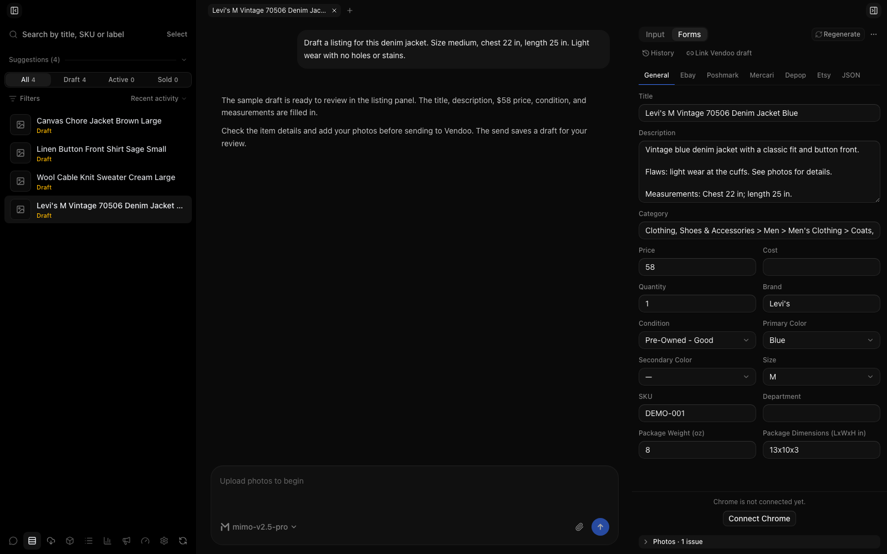
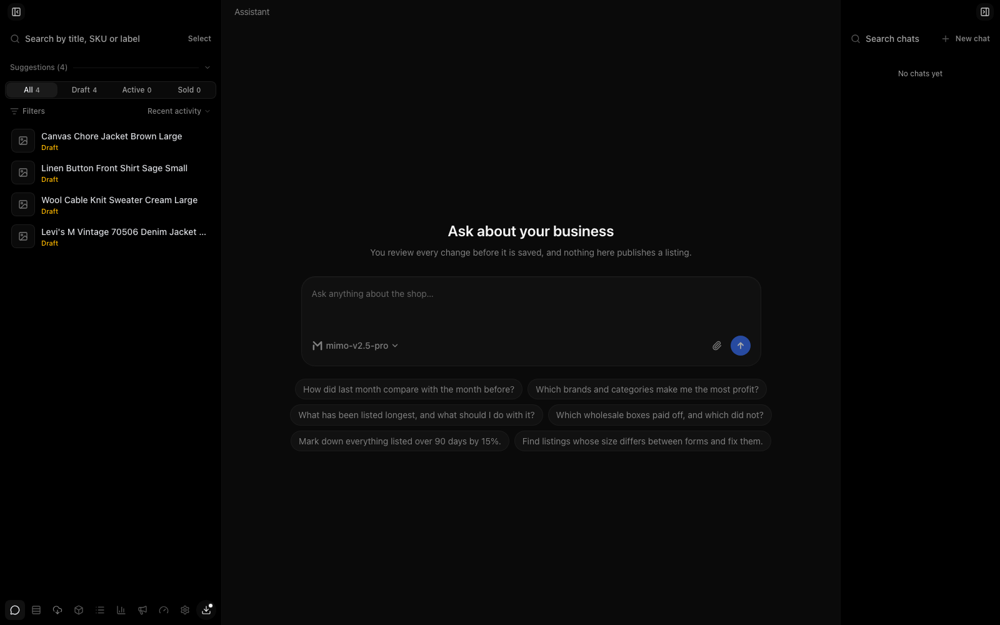
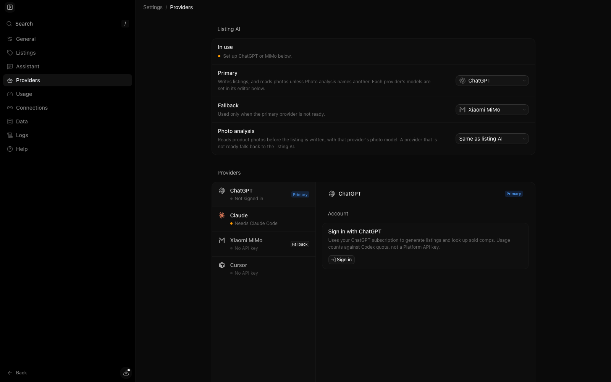

# Anteroom

[](https://github.com/btxbtwn/list-this-vendoo-suite/actions/workflows/ci.yml)

Turn product photos into marketplace listing drafts, review them in **Anteroom**, and send approved listings to Vendoo from your Mac. Automated sends stop at saved drafts. You choose when and where to publish.

Anteroom combines a listing editor, inventory, a business assistant, sales analytics, and wholesale sourcing. It uses the listing rules in this repository and a Chrome extension to fill Vendoo forms for eBay, Poshmark, Mercari, Depop, and eligible Etsy items.

[Download for Mac](https://github.com/btxbtwn/list-this-vendoo-suite/releases/tag/studio-macos) · [Run from source](#run-from-this-repo) · [Contribute](CONTRIBUTING.md)



*The current interface with sample listing content. Screenshots use a separate local database with no personal photos or connected accounts.*

## Direct marketplace listing

The local build supports direct drafts and seller-confirmed publishing to **Depop, Etsy, Poshmark, Mercari, Sellwild, and Vinted**, without requiring Vendoo. Use **Marketplaces** at the top of a listing's Input tab. Etsy uses its official API; Depop, Poshmark, Mercari, Sellwild, and Vinted use your signed-in Chrome session. Those browser connections have no confirmed marketplace authorization and carry account-enforcement risk. eBay's separate workspace uses its official API. Sign in to the Chrome marketplaces under **Settings → Connections**.

## From photos to a saved draft

1. Create a listing and drop in the item's photos, or upload folders to create several listings at once.
2. Add known details such as flaws, cost, SKU, and measurements. **Read from photos** can read measurements from ruler photos during bulk upload.
3. Generate the listing, then review the copy, price, categories, and marketplace fields in **Forms**. Use the item's chat to make changes.
4. Approve **Send to Vendoo**. The extension fills and saves a draft in Chrome; approved sends wait in the queue while another send is running.
5. Review the saved draft in Vendoo and publish to the marketplaces you choose.

Edits to an existing listing have two separate steps: **Update Vendoo** writes the Vendoo form, and a delist/relist in Vendoo updates the live marketplace copy. Anteroom tracks unsent edits and listings that still need a relist. See the [existing-listing workflow](vendoo-studio/README.md#editing-something-that-is-already-listed).

Open **Marketplaces** for each marketplace’s tools, sales planning, and ad history. eBay’s API marketing controls live under eBay; Etsy has a shop dashboard, orders, listings, and a Marketing tab for its sale calendar and ad CSV imports. Inventory-wide discount suggestions are in **Analytics → Inventory analytics**.

### Copy an item into a new draft

Choose the **Copy listing** action on an inventory row (the copy icon on desktop, or the row’s menu on a phone). Set the new inventory name, SKU and quantity. The SKU starts empty and quantity starts at one. You can copy the saved local photos and explicitly keep the recorded cost; cost starts unknown. The new item has its own draft, revision and photo files, with no sourcing-box assignment, marketplace links, jobs, chats or sales history. Deleting or rotating a copied photo leaves the original alone.

Saved listing fields, categories, form answers and seller Item Details are the starting point; review the copy’s description, condition, measurements and shipping before listing it. Creating the copy never contacts a marketplace. If the source changes while the dialog is open, reload its review before copying. A missing local photo stops the copy and removes any partial files/rows; restore the source photo or copy without photos. An item without saved listing fields can still become a partial draft from its Item Details and photos.

### Copy selected inventory items

Choose **Select → Copy items** for up to 300 inventory items. Review each new draft’s inventory name, SKU, quantity, photo option and cost option; uncheck any source to leave it out. Busy or missing sources show why they cannot be copied. **Create local drafts** processes one item at a time and reports every outcome. **Stop after current item** lets the active copy finish and leaves the rest waiting. **Continue remaining** or **Retry remaining** uses the same approved requests and leaves completed copies alone; **Review remaining** reloads only unconfirmed sources for a new review. **Open draft** opens a saved result.

A completed copy request is recorded with the new draft in the same database transaction. Repeating that request returns the same copy, including after a lost reply or a source change. Reusing it with different parameters is rejected. Deleting the copy keeps a receipt, so replaying its old request cannot recreate it. Failed copies leave no receipt or partial files. Individual copying also has **Check copy result** after an error. Batch progress is held in the open dialog; the created drafts and receipts persist in the database. All copying stays local and never publishes or delists.

### Bulk field and label editing

Choose **Select** in inventory, pick up to 300 items and choose **Edit fields**. Check the fields you want to replace: title, description, brand, size, SKU, price, cost or quantity. Unchecked fields stay as they are. Empty description, brand or SKU clears that field; empty cost means unknown. Prices and quantities are positive whole numbers. Choose whether to add, remove or replace labels; replacing with an empty list clears them.

**Review changes** shows each item’s before/after values, including dependent price and size fields the listing editor updates. Exclude individual rows before saving. An item that changed or started generating/sending after review is skipped with a reason; the other reviewed items still save. Items without photos can be edited, while Regenerate continues to require photos. Each saved edit is a listing revision that can be restored. Saving never calls a marketplace or changes a listing’s published state; direct updates, publishing and delisting are separate seller actions.

### Local sales records and exports

**Analytics → Sales records** opens local marketplace order lines, including dismissed sale alerts and cancellation/refund updates. Recover missing eBay or Etsy orders from that marketplace’s Orders tab. **Record amounts** saves seller-entered line totals: item revenue after discounts, shipping collected, revenue refunded, net fees, shipping cost and item cost, excluding buyer taxes. Choose the currency explicitly. Blank means unknown; enter zero when confirmed. Net fees can be negative for fee credits. Profit is shown only when all six amounts are known, and currencies are reported separately without conversion. An order or inventory-link change requires you to review the figures again; an older editor cannot overwrite a newer record.

**Export sales CSV** downloads every matching order line in the selected UTC dates and marketplace, across all pages. It includes recorded amounts, currency, IDs, order status and review flags. **Export inventory CSV** downloads current local listing details, quantity, recorded cost and validated saved marketplace URLs. Recorded inventory cost uses the same cost as Inventory analytics, including imported sale costs or a sourcing-box allocation when applicable. Inventory prices and costs have no inferred currency. Neither export includes private notes, photos or provider payloads. Spreadsheet formulas in text are escaped. Recording figures and exporting files make no marketplace changes and do not change inventory quantities.

### Native marketplace drafts

Use **Marketplaces** on a listing's Input tab to send directly to Poshmark, Mercari, Depop, Vinted and Etsy. Poshmark lists in one step: **List…** creates the live listing with the category, size (matched within Poshmark's size sets, such as Big & Tall), condition, brand and colors Anteroom has, with no Poshmark draft. Etsy uses its official API after connecting in **Settings → Connections**, without Chrome. Poshmark, Mercari, Depop and Vinted use your signed-in Chrome session from the extension's background: saving and publishing open no marketplace tab. A tab opens only when you connect or reconnect a marketplace.

1. **Save draft** copies the title, description, price, and photos. Depop has no title, so the draft uses the description only. Mercari also takes the listing's Mercari category, condition, zip code and package weight (required), with buyer-paid shipping; choose brand, size and shipping option on Mercari. Etsy requires its category and who/what/when-made details; choose shipping and processing profiles from your connected shop before creating a new draft. Anteroom reads the saved draft back and checks its contents. Etsy price changes preserve the existing SKU, quantity, and processing profile; drafts with multiple variations need their prices edited in Etsy Shop Manager.
2. **Open draft** to finish the marketplace fields and review the photos, price, and shipping. Updating an existing draft keeps its native photos.
3. **Publish…** asks you to confirm the item and one marketplace. Publishing runs only after this separate action, and is never queued or retried automatically.

After an interrupted response, use **Check result** or paste the saved draft link. Checking only reads the saved result. Save a changed Anteroom revision again before publishing it.

**Marketplaces** has one row per marketplace with its status (Not listed, Draft saved, Live, Sold here, Deleted) and the actions that apply. **Delist** works from the same rows. It lists every marketplace listing Anteroom knows for the item, including Vendoo's links, and removes the ones you pick after a confirmation: deleted on Etsy (official API), Poshmark, Mercari, Depop and Vinted, ended on eBay (Trading API `EndFixedPriceItem`; eBay has no delete), and delisted on Sellwild (its only seller removal). Each step reads the listing first, so a listing already gone counts as delisted and a delist is safe to repeat. The marketplace where the item sold is never touched, and nothing delists on its own.

Sellwild has no drafts, so Sellwild drafts stay in Anteroom. Choose a Sellwild category and condition (Anteroom suggests both from the listing), then **Save in Anteroom**. This works without Chrome and sends nothing to Sellwild. **Publish…** requires a separate confirmation. It then creates the listing once from the Bridge with your Sellwild session, without opening a tab: it uploads the photos and activates the listing, the same three steps Sellwild's own sell page takes. Publishing needs a package weight and `package_dimensions_in`, and a ship-from address saved on Sellwild. If Sellwild holds the listing for moderation, Anteroom shows **In review**. If a reply is lost after the listing was created, Anteroom shows its Sellwild ID and never creates it again.

Vinted lists like Mercari and Depop. **List…** asks you to confirm, then saves a Vinted draft in the background with no Vinted tab, reads that draft back, and publishes it as part of the same confirmation. It does not list through Vendoo. Sign in under **Settings → Connections**. If Chrome loses the reply, **Check result** reads Vinted and does not create the draft or listing again. When the result is unknown and no draft link was saved, paste the draft link (`https://www.vinted.com/items/…/edit`). **Delist** deletes that listing through the same Chrome sign-in, with no Vinted tab, after a separate confirmation. A sale on Vinted is detected when Detect sales is on, the same as the other Chrome marketplaces. Delist the other marketplaces still leaves Vinted up when the item sold there.

## Inside Anteroom

| Workspace | What you can do |
|---|---|
| Inventory | Search by title, SKU, or label; filter drafts, active items, and sales; review listing forms and revision history. |
| Assistant | Ask about sales, stale inventory, and sourcing results. Review proposed listing changes before applying them. |
| Analytics and Marketing | Explore sales and profit, track ad spend, and plan sale events. |
| Sourcing | Compare wholesale clothing boxes and track the items and returns from boxes you bought. |
| Settings | Choose AI providers, connect Chrome, manage backups, and configure private remote access through Tailscale. |

<details>
<summary>Business assistant</summary>

Ask about the shop across listings, sales, and sourcing. Each listing also has its own chat for item-specific work.



</details>

<details>
<summary>AI provider settings</summary>

Sign in with ChatGPT or Claude, or use your own API key for OpenAI, Anthropic, Google Gemini, xAI Grok, Mistral, OpenRouter (which can also connect by signing in), Xiaomi MiMo, or Cursor. API keys are billed by the provider per use and stay in macOS Keychain. Configure the primary listing provider, fallback, and photo analysis provider in **Settings → Providers**.



</details>

## Install on a Mac

You need **macOS 13+**, **Google Chrome**, a Vendoo account, and access to one of the supported AI providers. The app includes its Python runtime and frontend; recipients do not need Python, Node.js, or a clone of this repository.

1. Download `Anteroom-macos.zip` from the [Mac release](https://github.com/btxbtwn/list-this-vendoo-suite/releases/tag/studio-macos), unzip it, and read **How to Open.txt**.
2. Drag **Anteroom.app** into Applications. Control-click it and choose **Open** the first time; follow the included instructions if macOS warns about the developer.
3. Follow the setup guide or open **Settings → Providers**. Sign in with ChatGPT, Claude, or OpenRouter, or enter an API key for any listed provider.
4. Click **Connect Chrome**, then load Anteroom's unpacked extension once: open `chrome://extensions/`, enable **Developer mode**, and choose **Load unpacked**. Use the folder shown in **Settings → Connections** (normally `~/Library/Application Support/Anteroom/vendoo-extension` for the Mac app).
5. Sign in to Vendoo in that Chrome window. Confirm Anteroom shows the extension as connected before sending a listing.

Listings and photos are stored in `~/Library/Application Support/Anteroom`. **Check for updates** downloads and installs newer Mac builds while preserving that data.

Claude requires Claude Code installed on the Mac; its provider settings show the install and sign-in steps.

## Run from this repo

```bash
./setup.sh
./start.sh
```

Setup creates the Python environment, installs backend and frontend packages, and builds the frontend. Start runs the API at `http://127.0.0.1:4318` and opens the development UI at `http://127.0.0.1:5173`. Complete provider and Chrome setup as described above; development uses `vendoo-studio/data/` for app data.

Requirements: macOS, Python 3.12+, Node.js 20+, Google Chrome.

Quit another running Anteroom instance before starting from source; both use port `4318` by default. If setup or startup fails, run:

```bash
./vendoo-studio/scripts/doctor.sh
```

See the [Anteroom README](vendoo-studio/README.md) for backups, database migrations, packaging, backend development, and the `anteroom` command-line client.

## Command line

With the backend installed (`pip install -e .` from `vendoo-studio`), `anteroom` calls the local API. It prints `--json` for an assistant, and it will not delete, publish, or delist unless you pass `--confirm`. The app does not use an API key on loopback; save a base URL with `anteroom auth login`. An agent can read `anteroom commands --json` or connect to `anteroom mcp serve`. Details: [Command line](vendoo-studio/README.md#command-line).

## What's in the repo

| Path | Role |
|---|---|
| [`vendoo-studio/`](vendoo-studio/) | Anteroom: React + TypeScript frontend, FastAPI backend, SQLite storage, and Mac packaging. |
| [`vendoo-extension/`](vendoo-extension/) | Chrome MV3 extension, marketplace fill scripts, manual JSON popup, and page diagnostics. |
| [`skills/list-this/`](skills/list-this/) | Canonical listing rules, research workflow, JSON template, and marketplace dropdown references. |
| [`skills/box-scout/`](skills/box-scout/) | Wholesale clothing box research used by Anteroom's Sourcing workspace. |
| [`skills/measure-this/`](skills/measure-this/) | Garment measurement extraction from ruler photos, with two reads checked for agreement. |

## Chrome extension

Load the extension folder shown in **Settings → Connections** in `chrome://extensions/` (**Developer mode → Load unpacked**). The extension pairs automatically and runs in the background. Review listings and approve draft Sends in Anteroom; it owns photos, chat, progress, and diagnostics. See the [extension README](vendoo-extension/README.md) for setup and troubleshooting.

## Data and privacy

- Anteroom stores listings, chat, photos, and settings locally in SQLite and the app data folder. Automated snapshots support backup and recovery.
- AI requests send relevant photos and text to the provider you configure. Local storage does not make AI processing offline.
- API keys and ChatGPT tokens stay in macOS Keychain and are never included in SQLite, frontend responses, logs, or extension messages.
- The server binds to `127.0.0.1`. Optional remote access uses private Tailscale Serve for devices on your Tailnet.

## JSON contract

Anteroom, the listing skills, and the extension share a listing payload. This abbreviated example shows the structure; `ebay_specifics` keys use camelCase where shown. Category-dependent fields and allowed dropdown values come from the [canonical template](skills/list-this/references/vendoo_listing_template.md) and [listing skill](skills/list-this/SKILL.md).

<details>
<summary>Example listing JSON</summary>

```json
{
  "title": "Levi's M Blue Cotton Crew Neck T-Shirt",
  "description": "Blue cotton crew neck T-shirt...",
  "price": 25,
  "brand": "Levi's",
  "size": "M",
  "condition": "Good",
  "category_path": "Clothing, Shoes & Accessories > Men > Men's Clothing > Shirts > T-Shirts",
  "primaryColor": "Blue",
  "sku": "TEE-001",
  "quantity": 1,
  "weight_lb": 0,
  "weight_oz": 8,
  "package_dimensions_in": "13x10x3",
  "images": ["..."],
  "ebay_specifics": {
    "type": "T-Shirt",
    "department": "Men",
    "sizeType": "Regular",
    "size": "M",
    "brand": "Levi's",
    "fit": "Regular",
    "material": "Cotton",
    "pattern": "Solid",
    "style": "Basic",
    "features": "All Seasons",
    "neckline": "Crew Neck",
    "closure": "Pullover",
    "countryOfOrigin": "United States",
    "fabricType": "Jersey",
    "garmentCare": "Machine Wash",
    "handmade": "No",
    "personalize": "No",
    "vintage": "No",
    "occasion": "Casual",
    "season": "Summer",
    "unitQuantity": "1",
    "unitType": "Unit"
  },
  "depop_specifics": {},
  "etsy_specifics": {},
  "poshmark_specifics": {}
}
```

</details>

The complete template covers marketplace-specific fields beyond this example. Listing rules belong in `skills/`; app and extension code consume that contract.

## Build a zip to share

```bash
cd vendoo-studio
./scripts/setup.sh
source .venv/bin/activate
pip install -e ".[package]"
./scripts/package-macos-app.sh
```

That writes `vendoo-studio/release/Anteroom-macos.zip`. When you intend to publish a release, run `./scripts/publish-macos-release.sh` from `vendoo-studio/`. Pushes to `main` that touch the app, extension, or listing skills also build and update the rolling Mac release through [Studio macOS](.github/workflows/studio-macos.yml).

## Development

See [`CONTRIBUTING.md`](CONTRIBUTING.md) for PR checks and [`AGENTS.md`](AGENTS.md) for product invariants.

CI on pull requests and `main` lints, tests, and builds Anteroom, lints and tests the backend, syntax-checks and unit-tests the extension, validates skill JSON, and scans the tree for secrets. See the [CI workflow](.github/workflows/ci.yml) for the full checks and the [product specification](VENDOO_STUDIO_SPEC.md) for architecture.

## Acknowledgments

Anteroom includes code adapted from [T3 Code](https://github.com/pingdotgg/t3code), including UI components, theme styles, chat controls, and usage-limit helpers. Thanks to T3 Tools Inc. and the T3 Code contributors for making that work available under the MIT license.

The full copyright and license text is in the [third-party notices](vendoo-studio/public/third-party-notices.txt), which are also included in Anteroom app builds. Original attribution comments remain in the adapted source files.
