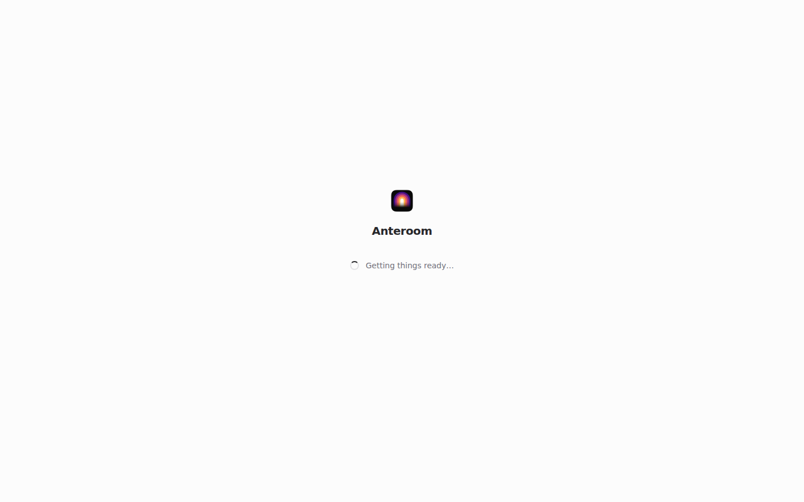
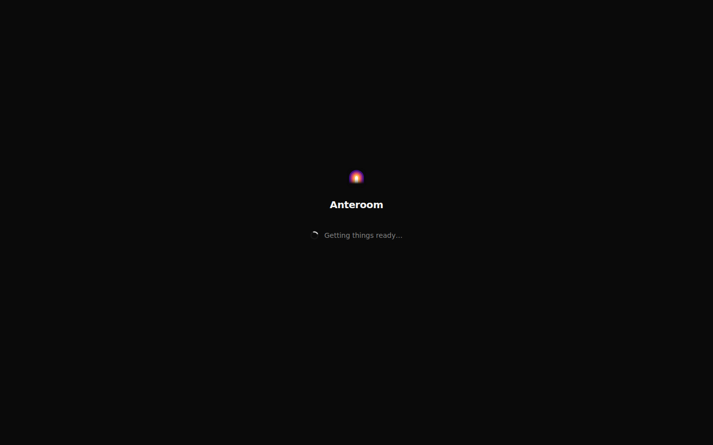
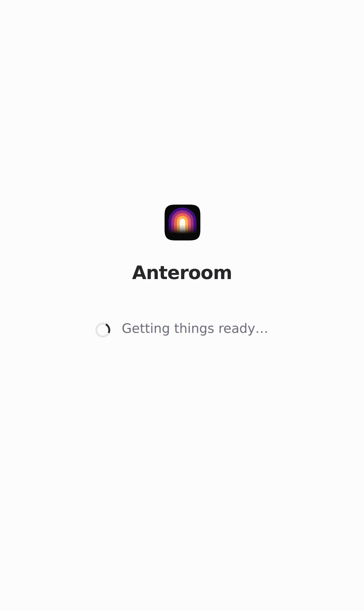
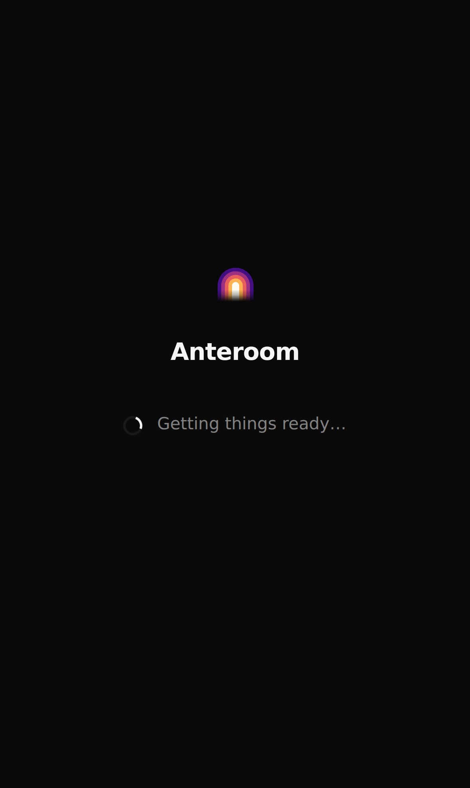

# Startup loading screen

The hosted web app renders this screen in its initial HTML while JavaScript downloads, then keeps the same presentation while it restores the session and opens the workspace. The loading message is “Getting things ready…”. The app icon, neutral colors, spacing and type follow `DESIGN.md`. The selected light, dark or system theme is applied before the first paint.

An indeterminate indicator follows [Apple's progress-indicator guidance](https://developer.apple.com/design/human-interface-guidelines/progress-indicators), because startup has no reliable completion percentage. Page-shaped skeletons remain inside the workspace, where the destination and content shape are known. There is no artificial minimum wait.

Waiting and error messages use status and alert roles following [WCAG status-message guidance](https://www.w3.org/WAI/WCAG22/Understanding/status-messages.html), without moving focus. Reduced motion disables the spinner animation. React startup offers reload after 10 seconds or immediately on an error.

These first-paint screenshots were captured from the local sandbox with the app module held back, at desktop (1440×900) and iPhone 15 sizes. They verify presentation, not startup speed. Concurrent-load p50/p95 latency was not measured by this presentation change.

| Desktop light | Desktop dark |
| --- | --- |
|  |  |

| Phone light | Phone dark |
| --- | --- |
|  |  |
