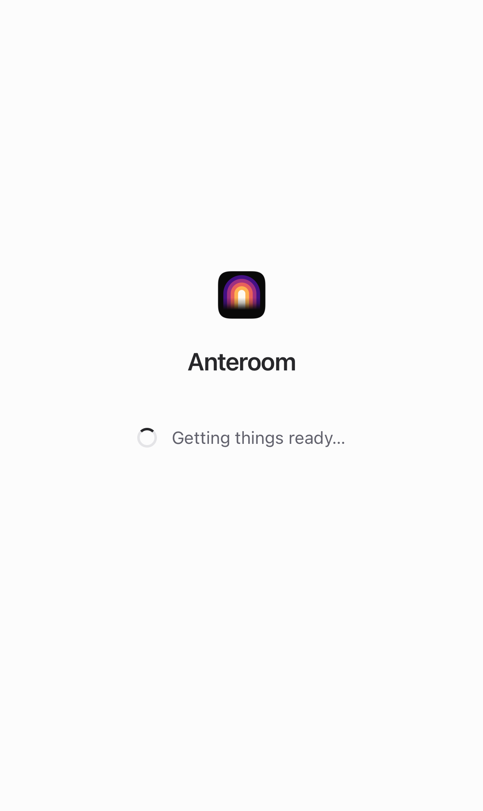
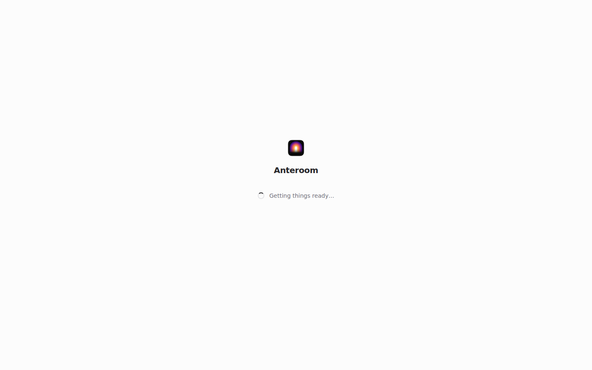
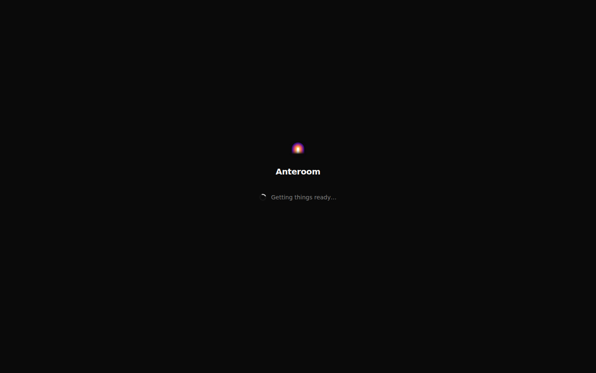
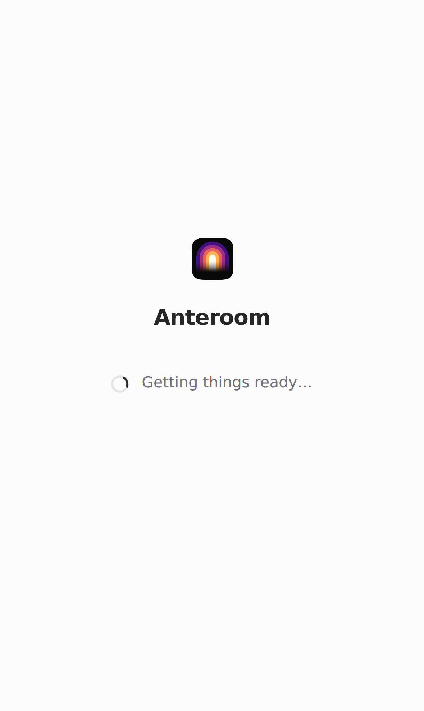
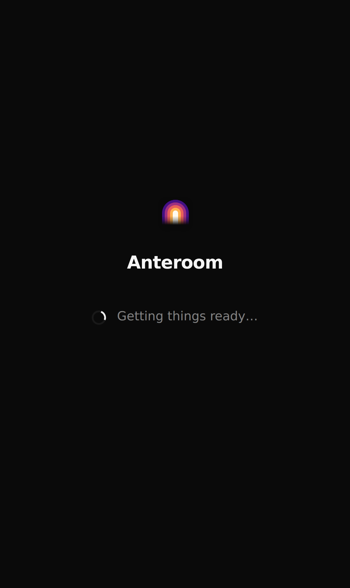

# Startup loading screen

The hosted web app renders the startup screen while JavaScript downloads, then keeps it while it restores the session and opens the workspace. The Mac app shows the same icon, title, spinner and “Getting things ready…” message before its local server starts. Both use the same layout stylesheet, and the local workspace keeps the layout until React mounts. The native splash matches the Mac window’s dark chrome. Once the workspace starts loading, it applies the selected light, dark or system theme.

An indeterminate indicator follows [Apple's progress-indicator guidance](https://developer.apple.com/design/human-interface-guidelines/progress-indicators), because startup has no reliable completion percentage. Page-shaped skeletons remain inside the workspace, where the destination and content shape are known. There is no artificial minimum wait.

Waiting and error messages use status and alert roles following [WCAG status-message guidance](https://www.w3.org/WAI/WCAG22/Understanding/status-messages.html), without moving focus. Reduced motion disables the spinner animation. The local and hosted startup screens offer reload after 10 seconds or immediately if the entry module fails to load.

The Mac splash was rendered in WebKit at 1440×900. The local workspace was captured at iPhone 15 size with the app module held back.

| Mac splash | Local workspace at phone size |
| --- | --- |
|  |  |

The web first-paint screenshots below were captured from the local sandbox with the app module held back. Concurrent-load p50/p95 latency was not measured by this presentation change.

| Desktop light | Desktop dark |
| --- | --- |
|  |  |

| Phone light | Phone dark |
| --- | --- |
|  |  |
